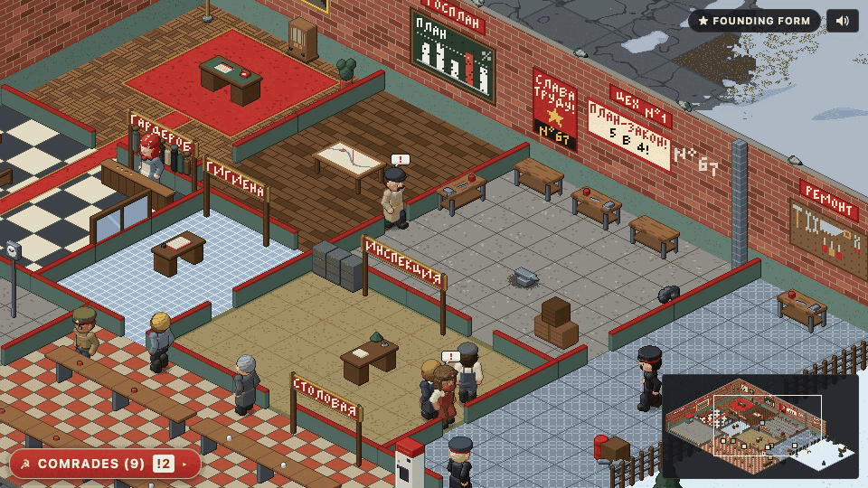
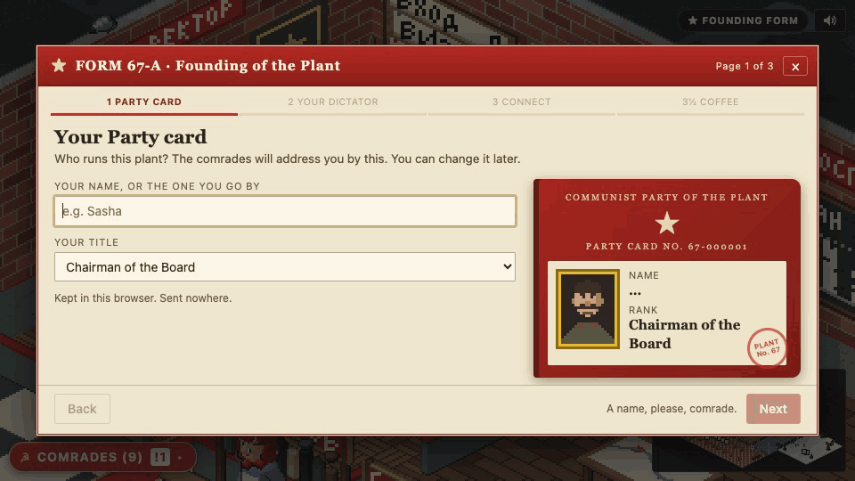
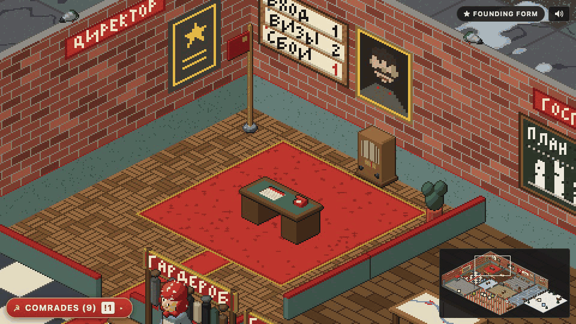
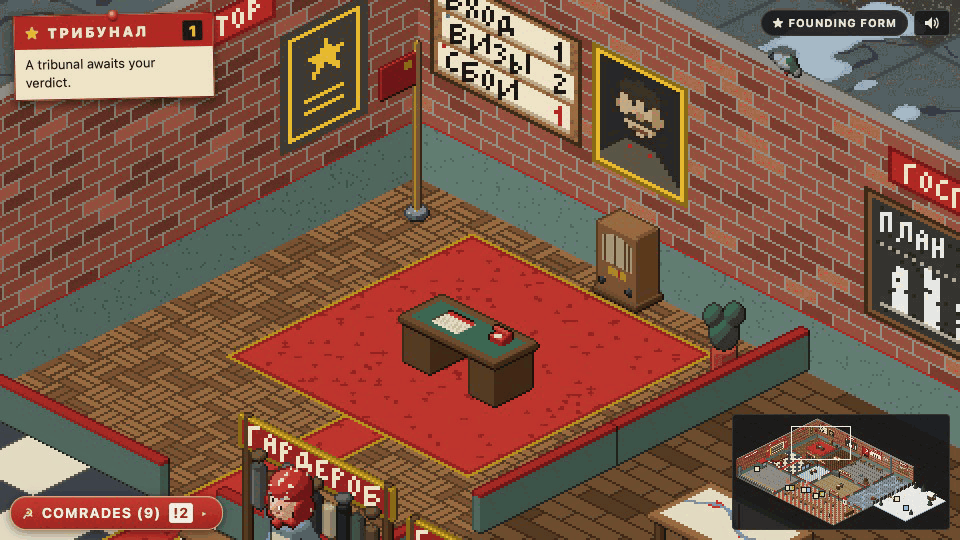

# The People's Plant #67



Who said agent orchestration had to be sensible? 

The People's Plant #67 is an orchestration front-end for unhinged souls. 

Inspired by /b, Reddit, Habbohotel and all the glorious corners of the web I grew up in (and learned the fine art of degeneracy within) - I present: 

- Your agents
- Drawn in a pixel-art, Soviet-Era factory 
- Your agents are represented by comrades who walk to their stations and work on your behalf
- Click one, send it a directive and watch it shuffle off
- If the agent gets stuck, it'll trot(ski) off to Siberia and shiver until you fix it
- Spin up a new agent and it arrives by train
- If your agent acts out of line it will be publicly executed in a show trial for other agents to see
- Loads of customisations and easter eggs included (up, up, down down...) 

Works at it's best with [Paperclip](https://github.com/paperclipai/paperclip). But it will also work with Claude Code and Codex. Open source under the MIT licence. Other harnesses can join through an [adapter](docs/ADAPTERS.md).

Comes complete with an onboarding wizard to get the most out of your People's Plant #67 instance. 

## Three ways in

**★ Just look.** The demo plant runs in your browser, nothing to install: [people-splant-67.github.io/the-peoples-plant-67](https://people-splant-67.github.io/the-peoples-plant-67/). Have a play and see what it can do. 

**★ Claude Code or Codex.** Node 20.19 or newer (on Node 22, 22.12 or newer), on macOS or Linux. No Node? Install the LTS version from [nodejs.org](https://nodejs.org/). Start the plant:

```bash
npx github:People-sPlant-67/the-peoples-plant-67
```

Leave it running. In a second terminal, wire your harness:

```bash
npx github:People-sPlant-67/the-peoples-plant-67 hooks claude
```

For Codex, use `hooks codex`, then type `/hooks` in Codex and trust the plant's hooks. Start a new session in a project folder, and it walks in.

**★ Paperclip.** A Chrome extension. Download the zip from [Releases](https://github.com/People-sPlant-67/the-peoples-plant-67/releases/latest), load it in `chrome://extensions`, and type the address you open Paperclip at.

The full steps, with updating, unwiring and every option, are in [docs/INSTALL.md](docs/INSTALL.md).

## Onboarding 101:Found the Ministry



The founding form opens on your first visit. Simply fill in your party card and choose your dictator: one of six made-up archetypes, a portrait you paint, or a photo pixelated into the plant's palette. With Paperclip, the form also gives you an order for your CEO agent. It hires a Director of Operational Hygiene, who keeps a Strike Ledger and refers repeat offenders to your tribunal. Pick the regime: Lenient (5 strikes), Standard (3) or Purge Season (1). [docs/ONBOARDING.md](docs/ONBOARDING.md) has the order in full.

## Life on the plant floor



**Directives.** Click a comrade, write to them, and their answer arrives in the plant. With Claude Code and Codex, the agent reads your directive with the next prompt you type in its terminal.



**Tribunals.** When the Director refers an agent, the court assembles in the Palace of Culture. Read the report, then hold a stamp: ВИНОВЕН (guilty) or ПОМИЛОВАН (pardoned, with a reason). Guilty means termination, and the comrade is airbrushed from the group photo.

## Your data

- **The extension** stores one thing in Chrome, your Paperclip's address. It runs inside your Paperclip tab, on the sign-in you already have. The plant keeps your choices there too, such as your name and portrait, in the browser's storage for your Paperclip site.
- **The bridge** keeps everything on your computer, in `~/.plant-67`, a folder only you can use. It opens the plant at a new private address each time it starts, behind a key only your link carries.

[SECURITY.md](SECURITY.md) explains how, and where the limits are.

## Something wrong?

Search [docs/TROUBLESHOOTING.md](docs/TROUBLESHOOTING.md) for the sentence the plant printed. Every message it prints in its terminal when something goes wrong has an entry.

## Build with us

- [docs/ADAPTERS.md](docs/ADAPTERS.md): wire another harness to the plant. Gemini CLI, OpenCode and Aider are waiting.
- [docs/PLANT-PROTOCOL.md](docs/PLANT-PROTOCOL.md): the API the plant reads.
- [CONTRIBUTING.md](CONTRIBUTING.md): set up, test, and send a change.

Made by Joe Whittaker - The Chief Engineer. 
If the plant made you smile, you can [buy me a coffee](https://buymeacoffee.com/thechiefengineer).
